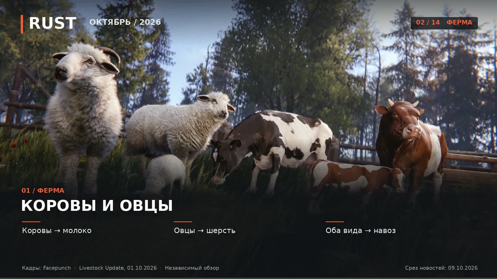

# Что нового добавили в RUST в октябре 2026

Русский независимый обзор обновления **Livestock Update от 1 октября 2026 года**, по состоянию на 9 октября. Продолжительность — **3:42**, разрешение — **1920×1080**, 30 кадров/с. Русская синтетическая озвучка, субтитры и лёгкий юмор.

[Скачать видео MP4](https://github.com/nicoomartinezpsplus-coder/video-rust/raw/refs/heads/main/rust-october-2026.mp4) · [Русские субтитры](rust-october-2026.ru.srt) · [Текст озвучки](narration-ru.txt)

В обзоре: коровы и овцы, продажа животных, молоко и сливки, биотопливо, новые обитатели острова, ремонт вертолётной площадки, мешки с песком, комнаты с лутом электросети, предохранители, клиентское предсказание бросков и оптимизация памяти.

[Источники и условия использования](SOURCES.md). Игровые кадры принадлежат Facepunch и используются по правилам для фанатских видео; они не являются CC0. Музыка создана для ролика. Озвучка — Piper Denis; карточка модели указывает CC0 для датасета. Ролик не связан с Facepunch и не одобрен студией.

Сценарий и привязка материалов: [scenes.json](scenes.json). Результаты технической проверки: [validation.json](validation.json). Полное декодирование видео и звука прошло без ошибок.
